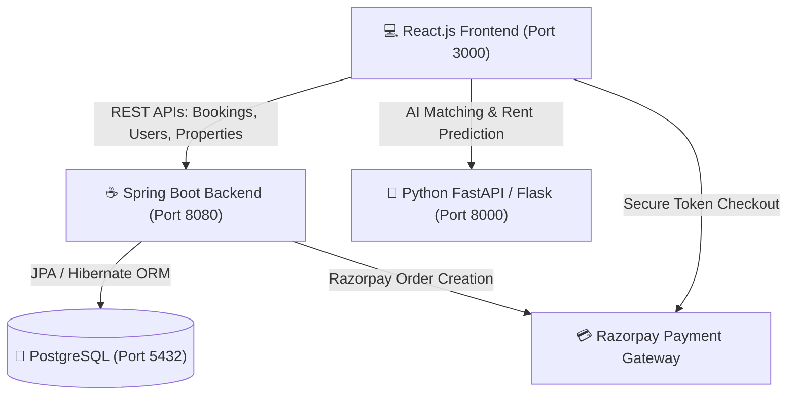

# 🌟 AlgoRooms (SpaceMatch)
### **Full-Stack PG & Hostel Booking System with AI Recommendation & Razorpay Integration**

AlgoRooms (also known as SpaceMatch) is an intelligent, full-stack student accommodation and PG/Hostel management platform designed for college campuses (specifically tailored for Meerut and institutions like MIET, Subharti, CCSU).

The system integrates **React.js**, **Spring Boot**, **PostgreSQL**, **Python ML / FastAPI**, and the **Razorpay Payment Gateway** to provide smart AI property matching, interactive map exploration, fake listing detection, a two-stage booking approval workflow, and an Admin management portal.

---

## 📑 Table of Contents
- [Architecture & Tech Stack](#-architecture--tech-stack)
- [Key Features](#-key-features)
- [Booking & Payment Workflow (Two-Stage Process)](#-booking--payment-workflow-two-stage-process)
- [Role-Based Access Control](#-role-based-access-control)
- [Machine Learning & AI Modules](#-machine-learning--ai-modules)
- [Project Directory Structure](#-project-directory-structure)
- [API Endpoints Reference](#-api-endpoints-reference)
- [Setup & Installation Guide](#-setup--installation-guide)
  - [1. Prerequisites](#1-prerequisites)
  - [2. Database Setup (PostgreSQL)](#2-database-setup-postgresql)
  - [3. Backend Setup (Spring Boot)](#3-backend-setup-spring-boot)
  - [4. AI Server Setup (Python FastAPI / Flask)](#4-ai-server-setup-python-fastapi--flask)
  - [5. Frontend Setup (React.js)](#5-frontend-setup-reactjs)
- [Razorpay Configuration & Test Mode](#-razorpay-configuration--test-mode)
- [Troubleshooting & FAQs](#-troubleshooting--faqs)

---

## 🏗️ Architecture & Tech Stack



| Layer | Technologies Used |
| :--- | :--- |
| **Frontend** | React 18, React Router v6, Axios, Leaflet / React-Leaflet, CSS3 |
| **Backend** | Java 17, Spring Boot 4, Spring Data JPA, Spring Security, Maven |
| **Database** | PostgreSQL 15+ |
| **AI / Machine Learning** | Python 3.10+, FastAPI, Flask, Scikit-Learn, Pandas, NumPy, Uvicorn |
| **Payment Gateway** | Razorpay Java SDK (`razorpay-java:1.4.8`), Razorpay Checkout.js |

---

## ✨ Key Features

1. **🤖 AI-Driven Matchmaker**:
   * Analyzes student preferences (budget, sharing type, AC, Wi-Fi, food type, distance to college).
   * Employs K-Nearest Neighbors (KNN) model to calculate match percentage scores (e.g. *95% AI Match*).
2. **🗺️ Interactive Campus Neighborhood Map**:
   * Interactive Leaflet map displaying real-time PG pins across Meerut landmarks (NH-58, Baghpat Road, Subharti, Modipuram).
   * Dynamic markers show price, amenities, and room preview photos.
3. **🛡️ 2-Stage Verified Booking & Razorpay Payment**:
   * **Stage 1**: Student submits a booking request to the PG owner without paying upfront.
   * **Stage 2**: PG owner reviews applicant details in the **Owner Dashboard** and clicks **Approve**.
   * **Stage 3**: Student opens **My Bookings** and completes the ₹500 Advance Token payment through the **Razorpay Payment Gateway**.
4. **🛠️ Admin Management Portal (`/admin`)**:
   * Comprehensive PG addition module with all attributes: Sharing type, City, Locality, Rent, AC, Wi-Fi, Meals, Laundry, Water, Power Backup, Security, and Reviews/Comments.
   * 1-Click Meerut landmark GPS coordinate presets (MIET, Subharti, Modipuram, Sharda Road, CCSU).
   * Live inventory overview with instant preview cards.
5. **🔍 ML Rent Predictor & Fake Listing Detector**:
   * **Rent Predictor**: Estimates fair monthly rental values based on amenities provided.
   * **Fake Detector**: Evaluates listings against historical pricing and photo counts to flag fraudulent listings.
6. **👥 3-Tier Role Authentication**:
   * Dedicated views for **Student / Tenant**, **PG Owner**, and **Administrator**.

---

## 🔄 Booking & Payment Workflow (Two-Stage Process)

To protect students from paying for unavailable rooms, AlgoRooms uses a verified two-stage confirmation process:

```
[Student browses PG]
         ↓
[Clicks 'View details' → Fills student info → Clicks 'Send Booking Request to Owner']
         ↓
[Database: status = 'PENDING', payment_status = 'UNPAID']
         ↓
[PG Owner opens Owner Dashboard (/owner) and reviews applicant]
         ↓
    ┌────────┴────────┐
    ▼                 ▼
[Approve]         [Reject]
    │                 │
    │ (status='CONFIRMED')
    ▼                 ▼
[Student visits 'My Bookings' (/my-bookings)]
[Status: "Owner Accepted!"]
[Button Unlocks: '💳 Pay ₹500 Token Now']
    │
    ▼
[Razorpay Checkout Opens (UPI, QR, Card, Netbanking)]
    │
    ▼
[Payment Verified → payment_status = 'PAID', payment_id saved]
[Room Reserved & Secured]
```

---

## 👤 Role-Based Access Control

| Role | Access URL | Capabilities |
| :--- | :--- | :--- |
| **🎓 Student** | `/`, `/my-bookings` | Explore PGs, run AI recommendations, submit booking requests, pay ₹500 token once approved, and view payment receipt IDs. |
| **🏠 Owner** | `/owner` | View incoming tenant requests, inspect applicant details and move-in dates, approve or reject bookings, and monitor payment statuses. |
| **🛠️ Admin** | `/admin` | Add new PG listings with full amenities, manage reviews and ratings, set GPS coordinates with presets, and monitor total inventory. |

---

## 🧠 Machine Learning & AI Modules

The `ai-models/` directory provides intelligent services powered by Scikit-Learn:

1. **KNN Recommendation Engine (`recommender.pkl` & `scaler.pkl`)**:
   * Normalized multi-parameter vector matching using Euclidean distance.
   * Compares `rent`, `distance_to_miet`, `sharing_type`, and `has_ac`.
2. **Price Predictor (`price_predictor.pkl`)**:
   * Regression model forecasting market-fair room rent based on `bed_sharing`, `ac`, `wifi`, and `meal`.
3. **Fake Listing Detector (`fake_detector.pkl`)**:
   * Classification model flagging unrealistic prices and sparse amenities/photo counts.

---

## 📂 Project Directory Structure

```
Pghostel booking system/
├── ai-models/                     # Python ML Services (FastAPI / Flask)
│   ├── ai_server.py               # Recommendation Flask server
│   ├── ml_api.py                  # FastAPI server (Price Predictor & Fake Detector)
│   ├── recommender.pkl            # Trained KNN recommendation model
│   ├── price_predictor.pkl        # Rent estimation model
│   ├── fake_detector.pkl          # Fraud listing detection model
│   └── scaler.pkl                 # Feature normalizer
├── backend/                       # Spring Boot Application (Java 17)
│   ├── pom.xml                    # Maven dependencies (Razorpay, JPA, Security, etc.)
│   └── src/main/
│       ├── java/com/miet/pgbooking/
│       │   ├── config/            # SecurityConfig, CORS, Schema Migrations
│       │   ├── controller/        # BookingController, PropertyController, UserController
│       │   ├── dto/               # PaymentOrderResponse
│       │   ├── entity/            # Booking, Property, User entities
│       │   ├── repository/        # Spring Data JPA Repositories
│       │   └── service/           # BookingService, PropertyService, UserService
│       └── resources/
│           └── application.properties # PostgreSQL & Razorpay credentials
├── frontend/                      # React.js Application
│   ├── public/
│   │   └── index.html             # Razorpay Checkout SDK script inclusion
│   └── src/
│       ├── components/
│       │   ├── AdminDashboard.jsx # Add PG with amenities & Meerut presets
│       │   ├── AiMatchmaker.jsx   # AI preference input & filter
│       │   ├── Login.jsx          # 3-role auth (Student, Owner, Admin)
│       │   ├── MapComponent.jsx   # Leaflet GPS map
│       │   ├── MyBookings.jsx     # Student bookings & Razorpay pay button
│       │   ├── Navbar.jsx         # Navigation bar with role links
│       │   ├── OwnerDashboard.jsx # Owner request approval
│       │   ├── PropertyList.jsx   # Property cards & grid
│       │   └── StayDialog.jsx     # Booking request modal
│       └── App.jsx                # Router configuration
└── dataset/                       # Seed CSVs (pg_catalog.csv, fake_pg_data.csv)
```

---

## 🔌 API Endpoints Reference

### 1. Spring Boot Backend (`http://localhost:8080`)
| Method | Endpoint | Description |
| :--- | :--- | :--- |
| `POST` | `/api/bookings/create-order` | Generates a ₹500 Razorpay Order ID |
| `POST` | `/api/bookings/request` | Submits initial booking request (`PENDING`, `UNPAID`) |
| `GET` | `/api/bookings` | Fetches all booking records |
| `GET` | `/api/bookings/phone/{phone}` | Fetches bookings by applicant phone number |
| `PUT` | `/api/bookings/{id}/status?status=CONFIRMED` | Owner approves or rejects booking |
| `PUT` | `/api/bookings/{id}/payment?paymentId=...` | Records completed ₹500 token payment |
| `GET` | `/api/properties` | Lists all PG accommodations |
| `POST` | `/api/properties/add` | Admin adds a new PG with amenities & coordinates |
| `POST` | `/api/users/login` | User authentication with BCrypt |
| `POST` | `/api/users/signup` | User registration |

### 2. Python AI Module (`http://localhost:8000`)
| Method | Endpoint | Description |
| :--- | :--- | :--- |
| `POST` | `/recommend-pg` | Returns KNN matched stays with match percentage |
| `POST` | `/predict-rent` | Calculates estimated rent based on selected amenities |
| `POST` | `/check-listing` | Evaluates if a listing is likely fake or suspicious |

---

## 🚀 Setup & Installation Guide

### 1. Prerequisites
* **Java**: JDK 17 or higher
* **Node.js**: v18.0.0 or higher & npm
* **Python**: v3.10+
* **PostgreSQL**: v14+ running on port `5432`

---

### 2. Database Setup (PostgreSQL)
1. Open pgAdmin or `psql` and create the database:
   ```sql
   CREATE DATABASE pgbooking_db;
   ```
2. Verify credentials in [`backend/src/main/resources/application.properties`](file:///d:/Pghostel%20booking%20system/backend/src/main/resources/application.properties):
   ```properties
   spring.datasource.url=jdbc:postgresql://localhost:5432/pgbooking_db
   spring.datasource.username=postgres
   spring.datasource.password=YOUR_POSTGRES_PASSWORD
   spring.jpa.hibernate.ddl-auto=update
   ```

---

### 3. Backend Setup (Spring Boot)
1. Navigate to the backend folder:
   ```powershell
   cd "backend"
   ```
2. Run the Spring Boot application using the bundled Maven wrapper:
   ```powershell
   .\mvnw.cmd spring-boot:run
   ```
3. The server starts on **`http://localhost:8080`**.

---

### 4. AI Server Setup (Python FastAPI / Flask)
1. Open a new terminal and navigate to `ai-models`:
   ```powershell
   cd "ai-models"
   ```
2. Create and activate a virtual environment (optional but recommended):
   ```powershell
   python -m venv venv
   .\venv\Scripts\activate
   ```
3. Install required libraries:
   ```powershell
   pip install fastapi uvicorn flask scikit-learn pandas numpy pydantic
   ```
4. Start the AI recommendation server:
   ```powershell
   python ai_server.py
   ```
   *(Or start `uvicorn ml_api:app --reload --port 8000` for the FastAPI module)*

---

### 5. Frontend Setup (React.js)
1. Open a new terminal and navigate to `frontend`:
   ```powershell
   cd "frontend"
   ```
2. Install npm dependencies:
   ```powershell
   npm install
   ```
3. Start the React development server:
   ```powershell
   npm start
   ```
4. The application opens at **`http://localhost:3000`**.

---

## 💳 Razorpay Configuration & Test Mode

The application supports both **Live Razorpay Test Mode** and a **Built-in Demo Simulation**:

### Using Real Razorpay Test Credentials (Free):
1. Sign up / Log in at [Razorpay Dashboard](https://dashboard.razorpay.com/).
2. Toggle the switch at the top to **Test Mode** (orange indicator).
3. Navigate to **Account & Settings** $\rightarrow$ **API Keys** $\rightarrow$ **Generate Test Key**.
4. Copy the **Key ID** (`rzp_test_...`) and **Key Secret**.
5. Paste them in [`backend/src/main/resources/application.properties`](file:///d:/Pghostel%20booking%20system/backend/src/main/resources/application.properties):
   ```properties
   razorpay.key.id=rzp_test_YOUR_ACTUAL_KEY
   razorpay.key.secret=YOUR_ACTUAL_SECRET
   ```
6. Restart the Spring Boot backend.

### Built-in Viva / Demo Mode:
If `razorpay.key.id` is left as `rzp_test_placeholder`, the system automatically detects this and performs a seamless demo payment simulation generating `pay_demo_<timestamp>`, bypassing the Razorpay 401 Unauthorized check and confirming the booking without errors.

---

## ❓ Troubleshooting & FAQs

### 1. Browser shows "Not secure"
* **Reason**: Accessing the app via your local IP (`http://192.168.x.x:3000`) instead of `http://localhost:3000`. Chrome automatically marks plain HTTP IP addresses as not secure.
* **Solution**: Always open **`http://localhost:3000`** in your browser.

### 2. "Oops! Something went wrong. Payment Failed" (401 Unauthorized)
* **Reason**: Razorpay checkout script was passed an unregistered key (`rzp_test_placeholder`).
* **Solution**: Handled automatically by the built-in demo fallback, or add a valid test key from your Razorpay Dashboard.

### 3. Connection Error / CORS Issues
* **Reason**: Frontend running on a different port or network interface not permitted by Spring Security.
* **Solution**: [`SecurityConfig.java`](file:///d:/Pghostel%20booking%20system/backend/src/main/java/com/miet/pgbooking/config/SecurityConfig.java) is configured with `setAllowedOriginPatterns` covering `localhost:*`, `127.0.0.1:*`, and `192.168.*:*`.

---

## 📄 License
This project is developed for educational, academic, and demonstration purposes (College Mini/Major Project).
Feel free to contribute, customize, or deploy!

